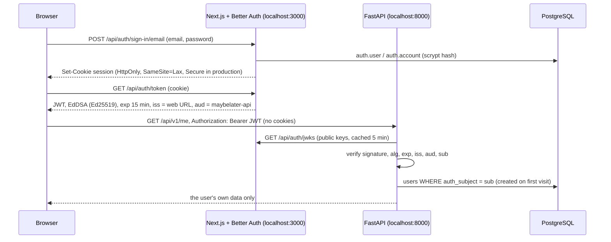

# MaybeLater — Authentication and Accounts (Stage 05)

Better Auth runs in the Next.js app and owns sign-up, sign-in and sessions. FastAPI never trusts the browser's word for who someone is: it verifies a signed token on every request.

## How the two apps share a session

| Decision | Why |
|---|---|
| Public-key verification (JWKS), not a shared secret | Only the web server can mint tokens; the API holds no secret that could forge one. Key rotation works without redeploying the API. |
| 15-minute tokens, held in memory in the browser | A leaked token expires fast. Tokens are never put in `localStorage`. `src/lib/api/token.ts` refreshes a token a minute before it expires. |
| Bearer header to the API, no cookies | A cross-site page cannot make authenticated API calls. This is CSRF protection by design: the API sets `credentials: "omit"`. |
| Better Auth tables in their own `auth` schema | The app's tables (`public`, managed by Alembic) and auth tables (managed by Better Auth) never collide or migrate each other. |

## Security requirements: how each is met

| Requirement | Implementation |
|---|---|
| Secure, HTTP-only cookies | Better Auth sets the session cookie with `httpOnly` and `SameSite=Lax`. `Secure` and the `__Secure-` prefix apply in production. |
| CSRF on state-changing requests | Better Auth's own endpoints check `Origin` against `trustedOrigins`. API calls carry a bearer header, never ambient cookies. |
| No plaintext passwords | Better Auth hashes with scrypt. Passwords must be 10–128 characters. |
| Session secret never public | `BETTER_AUTH_SECRET` is a server-only env var, never `NEXT_PUBLIC_`. The JWT private key is stored encrypted with it in `auth.jwks`. |
| API validates every protected request | The `current_user` dependency (`app/core/deps.py`) makes `TokenVerifier` (`app/core/auth.py`) check a JWT on every protected route. It allows the EdDSA algorithm only (no HMAC, no `none`), and requires `exp`, `iat` and `sub` with matching `iss` and `aud`. |
| Identity from the token only | The user is resolved from the verified `sub`. Request bodies reject unknown fields, so a `user_id` or `id` sent by the browser gets a 422 and is never used. |
| Ownership in every query | Services filter by the `current_user` id. The database backs this up with composite foreign keys (`docs/DATA_MODEL.md`). |
| Rate-limit login and recovery | Better Auth, stored in the database so the limits survive restarts. A per-IP limit is listed in the table after this one. The API rate-limits account deletion per user. |
| Don't reveal whether an email has an account | Sign-in failures always say "That email and password did not match". A sign-up with a taken email says "We could not create an account with those details. If you already have one, sign in instead." Neither confirms the account. See the limitation below. |
| Open redirects | The `?next=` parameter accepts same-site paths only (`safeNext`, unit-tested). |

Per-IP limits for Better Auth's endpoints:

| Endpoint | Limit |
|---|---|
| Sign-in | 5 per minute |
| Sign-up | 5 per 10 minutes |
| Password reset request | 3 per 10 minutes |
| Delete user | 5 per 10 minutes |
| Everything else | 100 per minute |

## Flows

| Flow | Where |
|---|---|
| Sign up, sign in | `/signup`, `/login` → `authClient.signUp.email` / `signIn.email`, then on to `next` (default `/app`) |
| Session restored on refresh | The cookie is checked on the server in `app/(app)/app/layout.tsx` (`requireSessionUser`, inside `<Suspense>` as Cache Components requires) |
| Protected routes and unauthenticated redirect | `src/proxy.ts` redirects early when there is no session cookie (fast, optimistic). The layout then really validates the session. |
| Session expired | An API 401 triggers a token refresh and one retry. If the retry also gets a 401, the app goes to `/login?reason=expired`, which shows "Your session ended. Sign in again to carry on." |
| Sign out | Settings → Sign out, which goes to `/login?reason=signed-out` |
| Account settings | `/app/settings`: display name and time zone, persisted through `PATCH /api/v1/me` |
| Account deletion | Settings → Delete my account → password. Better Auth verifies the password, then its `beforeDelete` hook calls `DELETE /api/v1/me`, which deletes every item, reminder and setting. Only after that succeeds is the sign-in account removed. A wrong password, or an API failure, deletes nothing. |

## API endpoints (FastAPI)

| Method | Path | Notes |
|---|---|---|
| GET | `/api/v1/me` | The signed-in user. The row is created on first contact from the token's `sub`, `email` and `name`. |
| PATCH | `/api/v1/me` | `display_name`, `timezone` (an IANA name, validated) and `preferences` (validated shape). Unknown fields get a 422. |
| DELETE | `/api/v1/me` | Deletes the user and everything they own. Rate-limited to 5 per 10 minutes. |

## Local setup

1. In `frontend/.env.local`, set `BETTER_AUTH_SECRET`, `BETTER_AUTH_URL=http://localhost:3000` and `AUTH_DATABASE_URL` (the same database as the API, as a plain `postgresql://` URL).
2. In `backend/.env`, set `AUTH_BASE_URL=http://localhost:3000`. `AUTH_JWKS_URL` defaults to `{AUTH_BASE_URL}/api/auth/jwks`, and `AUTH_AUDIENCE=maybelater-api`.
3. Create the auth tables with `cd frontend && npm run auth:migrate`. It creates `auth.user`, `session`, `account`, `verification`, `jwks` and `rateLimit`.
4. Start the API on port 8000 and the web app on port 3000. The API can start first: it fetches the public keys lazily on the first authenticated request.

**Callback URLs:** email and password only, so there are no OAuth callbacks yet. Better Auth serves everything under `/api/auth/*` on the web origin. In production, `BETTER_AUTH_URL`, `AUTH_BASE_URL` and the CORS origins must be the https site URL. The API refuses to start otherwise.

## Tests

| Layer | File | Covers |
|---|---|---|
| API | `backend/tests/test_auth.py` | No token, malformed headers; expired, wrong-audience, wrong-issuer and wrong-key tokens; missing claims; forged HS256 and `none` tokens. First-visit user creation, no duplicates, body `id` ignored. Settings persist and are validated. Deletion removes only the caller's data. Per-user rate limit. |
| Web, unit | `src/lib/api/client.test.ts`, `token.test.ts`, `src/features/auth/auth-form.test.ts` | Bearer attached, retry with a fresh token, session-ended handler, no API call without a session, token cache and sharing, safe redirects |
| End to end | `frontend/e2e/auth.spec.ts`, run at 1440 and 390 | Unauthenticated redirect with `next`. Sign-up, refresh keeps the session, the API returns the user, settings persist, sign-out, redirect, vague wrong-password message with input kept, duplicate sign-up reveals nothing, sign-in, deletion with a wrong and then the right password, and the account is gone. |

Run the end-to-end tests with both servers up: `PLAYWRIGHT_CHANNEL=chrome npx playwright test --project=desktop`. The channel variable uses your installed Chrome; alternatively run `npx playwright install`.

## Known limitations

- **Email verification and password reset need an email sender**, and none is configured, so neither is offered yet. Without verification, sign-up cannot fully hide whether an email is taken, though the message never confirms it.
- The API caches the public keys for 5 minutes and refetches them when an unknown key id appears, so key rotation needs no API restart.
- A 15-minute token stays valid until it expires, even after sign-out. The browser drops it on sign-out, and the session itself ends at once.
