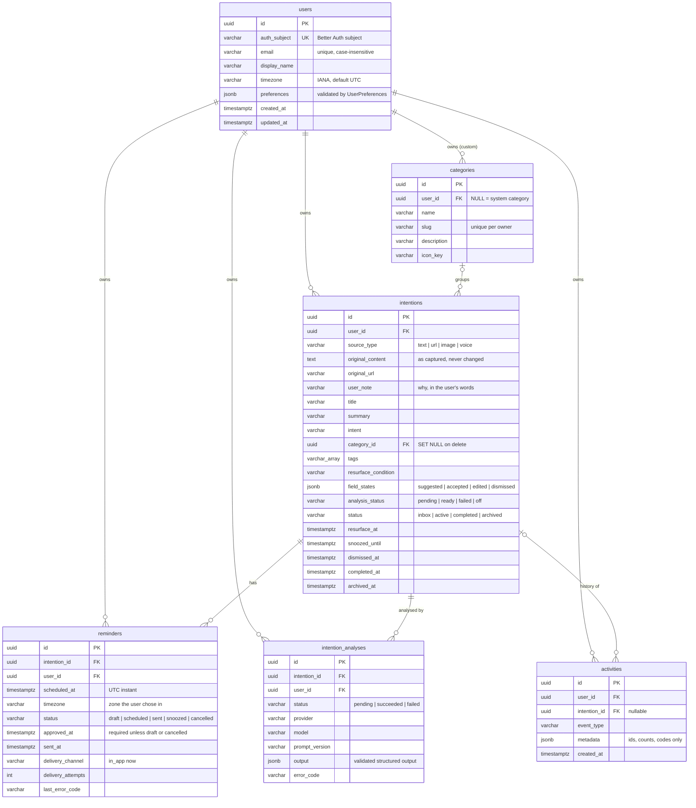

# MaybeLater — Data Model (Stage 04)

PostgreSQL schema built from SQLAlchemy 2 models (`backend/app/models/`) and managed only by Alembic migrations (`backend/alembic/versions/`). There is no `create_all()` anywhere.

## Diagram



## Rules and where they are enforced

| Rule | How |
|---|---|
| UUID primary keys | `gen_random_uuid()` server default, plus `uuid4` in the ORM |
| UTC storage | Every timestamp is `timestamptz`. The user's IANA zone is kept on `users.timezone` and on each reminder's `timezone`. |
| Valid statuses and types | `CHECK … IN (…)` constraints that mirror `app/models/enums.py`. Text columns are used instead of native enums so values can change in a migration. |
| A child row never points at another user's intention | `reminders`, `activities` and `intention_analyses` reference `intentions(id, user_id)` together through a composite foreign key. |
| No reminder without consent | `ck_reminders_approved_before_scheduling`: a reminder that is scheduled, snoozed or sent must have `approved_at`. AI can propose a draft; only a person schedules. |
| Original content kept apart from AI | Capture fields (`original_content`, `original_url`, `user_note`) are separate from interpretation fields. Raw AI output lives in `intention_analyses.output`. |
| AI never overwrites user edits | `intentions.field_states` maps each editable field (title, summary, intent, category, tags, resurface_condition) to `suggested`, `accepted`, `edited` or `dismissed`. AI writes a field only when its state is absent or `suggested`. Stage 07 implements this rule in the service. |
| URL captures have a URL | `source_type <> 'url' OR original_url IS NOT NULL`, and the URL must start with http(s). |
| Completed and archived items carry a timestamp | CHECK constraints on `completed_at` and `archived_at` |
| Bounded sizes | Length CHECKs on content, plus up to 20 tags per item |
| Uniqueness only where the product needs it | One app user per `auth_subject`. One account per email, case-insensitive. Category slugs unique among system categories, and unique per user for custom ones. |

## Indexes

| Index | Serves |
|---|---|
| `ix_intentions_user_created` (user_id, created_at DESC, id DESC) | Inbox list and cursor pagination |
| `ix_intentions_user_status_created` | Status filters |
| `ix_intentions_user_resurface_at` (partial: open items with a date) | Resurfacing |
| `ix_intentions_user_snoozed_until` (partial) | Snooze expiry |
| `ix_intentions_tags` (GIN) | Tag filter |
| `ix_reminders_due` (partial: scheduled or snoozed) | The delivery worker's due scan |
| `ix_reminders_user_scheduled` | A user's reminder list |
| `ix_activities_user_created` | History and metrics |

Text search (stage 09) starts with plain PostgreSQL queries. Full-text search or pgvector is added by a later migration only if the need is shown.

## Deletion and retention

| Delete | Effect |
|---|---|
| An intention | Its reminders, analyses and activities are deleted with it. No orphaned reminders. |
| A category | Intentions keep existing; their `category_id` becomes NULL. |
| A user (account deletion) | Everything they own is deleted: intentions, custom categories, reminders, analyses, activities. System categories stay. |

Further privacy rules:
- Deletes are **hard deletes**. There is no soft-delete copy of saved content.
- **No scraped page bodies are stored.** Analyses keep only the validated structured output, plus provider, model and prompt version.
- `activities.metadata` and `last_error_code` hold codes and ids, never titles, URLs or notes.
- The seed data contains only the system category list.

## Auth tables

Better Auth manages its own tables (`user`, `session`, `account`, `verification`, `jwks`, `rateLimit`) in the separate **`auth` schema** of the same database, created by `npm run auth:migrate` in `frontend/`. Alembic only manages `public`. The verified token's subject links the two through `users.auth_subject`. Account deletion removes both: the app data first (through the API), then the auth account (`docs/AUTH.md`).

## Working with migrations

```bash
cd backend
alembic upgrade head                               # apply
alembic revision --autogenerate -m "describe it"   # after changing a model; always review the file
alembic downgrade -1                               # step back one migration
```

- Never edit a migration that has run in a shared environment; add a new one instead.
- `tests/test_migrations.py` runs against `TEST_DATABASE_URL`. It checks a fresh install, a full downgrade and re-upgrade, and fails if the models and the migrations ever differ.
- `tests/test_schema_rules.py` checks the constraints above against the real database.
